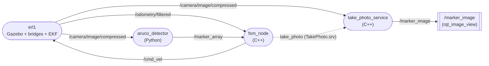

# ER_Assignment1 – ArUco Treasure Hunt

ROS 2 project for the Experimental Robotics Laboratory course's first assignment. A differential drive robot finds four ArUco markers one after the other and carries out the action linked to each one:

| Marker | Action |
|--------|--------|
| 1 | Turn right 90° and move forward |
| 2 | Rotate 180° and move forward |
| 3 | Turn left 90° and move forward |
| 4 | Stop: treasure found |

## Requirements

- Ubuntu 24.04 (native or WSL 2)
- ROS 2 Jazzy/Humble and Gazebo Harmonic (`ros-jazzy-ros-gz`)
- `robot_localization`, `cv_bridge`, `python3-opencv`
- Optional: `xterm` (`sudo apt install xterm`) to open the photo service in its own window

## Packages

- `assignment`: the ArUco detector node (Python), the finite state machine (C++), the config and the launch file
- `assignment_interfaces`: the custom messages (`Marker`, `MarkerArray`), the `TakePhoto` service and its server node
- `erl1`: the models' package (Gazebo world, robot model, bridge, EKF)

## Node graph

Rounded boxes are nodes, arrows are topics (solid) and services (dashed). Everything started by `erl1/launch/spawn_assignment.launch.py` (Gazebo, bridges, robot state publisher, EKF, RViz) is shown as a single `erl1` node.



- `aruco_detector` finds the markers in every camera frame and publishes their id, center and side on `/marker_array`.
- `fsm_node` reads the markers and the filtered odometry, drives the robot through `/cmd_vel` and calls the `take_photo` service when it reaches a marker.
- `take_photo_service` draws a circle and the "id N" label on the current frame and publishes it once on `/marker_image` with an image_transport publisher (so `/marker_image/compressed` is available too).

Both camera consumers subscribe **only to the compressed (JPEG) stream** (`sensor_msgs/CompressedImage`): the full topic name is the `image_topic` parameter, `/camera/image/compressed` in `config/sim.yaml` and `/rosbot_1/camera/rgb/image_raw/compressed` in `config/rosbot.yaml`.

## 1. One-time setup: Gazebo models

The simulation world needs the `aruco_box_1..4` models in `~/gazebo_models` from the repository inside [CarmineD8/erl1](https://github.com/CarmineD8/erl1). Copy them once, then make the folder visible to Gazebo:

```bash
echo 'export GZ_SIM_RESOURCE_PATH=$GZ_SIM_RESOURCE_PATH:$HOME/gazebo_models' >> ~/.bashrc
source ~/.bashrc
```

## 2. Build and run (simulation)

### Scripted build and run

The repository folder is also the colcon workspace. From that folder in WSL/Ubuntu, run:

```bash
./run_sim.sh
```

This single command:
1. closes any simulation processes left over from a previous run
2. sources ROS 2 Jazzy and makes the Gazebo models visible
3. builds all packages (`colcon build --symlink-install`)
4. launches Gazebo, RViz, the ArUco detector, the FSM and the photo service (`sim.launch.py`)

Options:

| Command | Effect |
|---------|--------|
| `./run_sim.sh --clean` | Deletes `build/`, `install/` and `log/` before building (use it if the build fails because of old files) |
| `./run_sim.sh rviz:=false` | Launches without RViz (any `<arg>:=<value>` is passed to `ros2 launch`) |
| `./run_sim.sh rosbot` | Builds and launches `rosbot.launch.py` (detector, FSM, photo service for the real ROSbot, no Gazebo/RViz). Without this flag the Gazebo simulation (`sim.launch.py`) is launched |
| `./run_sim.sh --clean rosbot` | Flags can be combined, in any order |

To stop everything, press **Ctrl+C** or close the Gazebo window. The script then shuts down every node.

### Manual build and run (without the script)

```bash
source /opt/ros/jazzy/setup.bash
colcon build --symlink-install
source install/setup.bash
ros2 launch assignment sim.launch.py
```

## 3. Check that it works

Open a second terminal and source the workspace (`source install/setup.bash`), then try these:

```bash
ros2 topic echo /marker_array        # detected markers: id, center (u, v), side in px
ros2 run rqt_image_view rqt_image_view /marker_image   # annotated photo of each marker
```

Expected behaviour: the robot drives towards marker 1, centres it and approaches it, takes the photo, performs the marker action, and repeats this for markers 2 and 3. At marker 4 it stops and prints a completion message.

## Development history

See commits.
