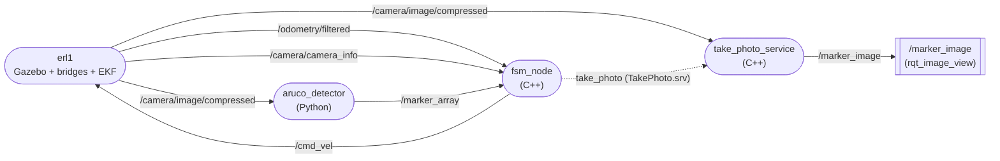

# ER_Assignment1 – ArUco Treasure Hunt

ROS 2 project for the Experimental Robotics Laboratory course (Assignment 1). A differential-drive robot visits ArUco markers 1→4 in sequence and executes the action bound to each one.

| Marker | Action |
|--------|--------|
| 1 | Rotate −90° (right), then move forward |
| 2 | Rotate 180°, then move forward |
| 3 | Rotate +90° (left), then move forward |
| 4 | Stop (treasure found) |

## Requirements

- Ubuntu 24.04 (native or WSL 2)
- ROS 2 Jazzy, Gazebo Harmonic (`ros-jazzy-ros-gz`)
- `robot_localization`, `cv_bridge`, `python3-opencv`
- `ros-jazzy-rmw-cyclonedds-cpp`
- Optional: `xterm` (opens the photo service in a separate window)

## Packages

| Package | Content |
|---------|---------|
| `assignment` | ArUco detector (`aruco_image_detector.py`), FSM (`FSM.cpp`), config, launch files |
| `assignment_interfaces` | `Marker`, `MarkerArray` messages; `TakePhoto` service and server node |
| `erl1` | Gazebo world, robot model, bridges, EKF |

## System Architecture

`erl1/launch/spawn_assignment.launch.py` (Gazebo, bridges, robot_state_publisher, EKF, RViz) is shown as a single node.



| Node | Inputs | Outputs |
|------|--------|---------|
| `aruco_detector` | `CompressedImage` | `/marker_array` (`MarkerArray`) |
| `fsm_node` | `/marker_array`, `/odometry/filtered`, `/camera/camera_info` | `/cmd_vel`; client of `take_photo` |
| `take_photo_service` | `CompressedImage`, `take_photo` request | `/marker_image` (annotated frame, once per request) |

Both camera consumers subscribe **only to the compressed (JPEG) stream**; the raw image is never transferred. The topic is set by the `image_topic` parameter:

- `config/sim.yaml`: `/camera/image/compressed`
- `config/rosbot.yaml`: `/camera/rgb/image_raw/compressed`

## DDS Middleware

All nodes use Cyclone DDS (`rmw_cyclonedds_cpp`). Both launch files and `run_sim.sh` set `RMW_IMPLEMENTATION` for the processes they start. For `ros2` commands issued from other terminals:

```bash
echo 'export RMW_IMPLEMENTATION=rmw_cyclonedds_cpp' >> ~/.bashrc
source ~/.bashrc
ros2 daemon stop    # restart the CLI daemon with the new RMW
```

On the real ROSbot, also export the robot's `ROS_DOMAIN_ID` (10, 11 or 12) and use Cyclone DDS on the robot side.

---

# Technical Design

## Finite State Machine

The FSM runs at 10 Hz. Inputs: ArUco observations, filtered odometry, camera calibration. Output: `/cmd_vel`.

```text
START → MOVE → ALIGN_AND_APPROACH → TAKE_PHOTO → EXECUTE → ROTATE → MOVE → ... → FINISH
```

| State | Behaviour |
|-------|-----------|
| `START` | Waits for odometry and `CameraInfo` before enabling motion |
| `MOVE` | Drives forward at `forward_speed` until the current target marker is detected |
| `ALIGN_AND_APPROACH` | Image-based visual servoing: centres and approaches the marker |
| `TAKE_PHOTO` | Calls `take_photo`, blocks until the response |
| `EXECUTE` | Selects the action for the marker ID (see table above) |
| `ROTATE` | Closed-loop rotation on filtered odometry |
| `FINISH` | Zero velocity after marker 4 |

Only the current target marker (IDs processed in order 1→4) is considered; other detections are ignored.

## Visual Servoing

No marker pose estimation is performed. The controller uses two image-space features from the detector: the horizontal centre `u` and the apparent side length `side` (px).

**Heading** (P control on horizontal error):

```text
u_error = u - cx
ω = -k_omega · u_error
```

**Distance** (apparent size as range proxy):

```text
side_error = desired_side - side
v = k_v · side_error
```

**Reached condition:**

```text
|u_error| < u_tolerance  AND  |side_error| < side_tolerance
```

**Calibration scaling.** `cx` and `fx` are read from `/camera/camera_info`. The target side is scaled with the focal length so the same gains apply across cameras:

```text
desired_side = reference_side · fx / reference_fx
```

## Rotation Controller

```text
target_yaw = current_yaw + rotation_angle
yaw_error  = atan2(sin(target_yaw - robot_yaw), cos(target_yaw - robot_yaw))   // wrapped to (-π, π]
ω = k_rot · yaw_error
```

Rotation ends when `|yaw_error| < yaw_tolerance`.

## Marker Detection

Pipeline: `CompressedImage → JPEG decode → grayscale → ArUco detection (DICT_ARUCO_ORIGINAL) → feature extraction → MarkerArray`.

Per marker: `id`, centre `(u, v)`, mean side length in pixels. A `MarkerArray` is published for every frame; an empty `markers` array means no detection.

## Photo Service

Triggered by the FSM on `TakePhoto.srv`. On each request the server:

1. Re-detects ArUco markers in the latest frame
2. Computes each marker centre
3. Draws a green circle and the `id N` label
4. Publishes the annotated image once on `/marker_image`

The FSM resumes only after the service response.

---

# ROS Interfaces

### `Marker.msg`

```text
int32   id      # ArUco ID
float32 u       # horizontal centre [px]
float32 v       # vertical centre [px]
float32 side    # mean side length [px]
```

### `MarkerArray.msg`

```text
std_msgs/Header header
Marker[] markers    # empty if no marker detected
```

### `TakePhoto.srv`

```text
bool request
---
bool success
int32 marker_id
```

## Parameters (`fsm_node`)

| Parameter | Description |
|-----------|-------------|
| `forward_speed` | Linear speed in `MOVE` |
| `k_omega` | Visual-servoing angular gain |
| `k_v` | Visual-servoing linear gain |
| `k_rot` | Rotation controller gain |
| `u_tolerance` | Centring tolerance [px] |
| `side_tolerance` | Distance tolerance [px] |
| `yaw_tolerance` | Rotation completion threshold [rad] |
| `reference_side` | Desired marker side at `reference_fx` [px] |
| `reference_fx` | Reference focal length [px] |

---

# Setup and Usage

## 1. Gazebo models (one-time)

Copy the `aruco_box_1..4` models from [CarmineD8/erl1](https://github.com/CarmineD8/erl1) into `~/gazebo_models`, then expose the folder to Gazebo:

```bash
echo 'export GZ_SIM_RESOURCE_PATH=$GZ_SIM_RESOURCE_PATH:$HOME/gazebo_models' >> ~/.bashrc
source ~/.bashrc
```

## 2. Build and run

### Scripted (`run_sim.sh`)

The repository root is the colcon workspace:

```bash
./run_sim.sh
```

Steps performed:

1. Kills leftover simulation processes
2. Sources ROS 2 Jazzy and sets the Gazebo model path
3. Builds with `colcon build --symlink-install`
4. Launches `sim.launch.py` (Gazebo, RViz, detector, FSM, photo service)

| Command | Effect |
|---------|--------|
| `./run_sim.sh --clean` | Removes `build/`, `install/`, `log/` before building |
| `./run_sim.sh rviz:=false` | Any `<arg>:=<value>` is forwarded to `ros2 launch` |
| `./run_sim.sh rosbot` | Launches `rosbot.launch.py` (detector, FSM, photo service; no Gazebo/RViz) |
| `./run_sim.sh --clean rosbot` | Flags are combinable in any order |

Stop with **Ctrl+C** or by closing the Gazebo window; the script terminates all nodes.

### Manual

```bash
source /opt/ros/jazzy/setup.bash
colcon build --symlink-install
source install/setup.bash
ros2 launch assignment sim.launch.py
```

## 3. Verification

In a second terminal (`source install/setup.bash`):

```bash
ros2 topic echo /marker_array                           # id, (u, v), side [px]
ros2 run rqt_image_view rqt_image_view /marker_image    # annotated photos
```

Expected sequence: for markers 1–3, approach → photo → marker action; at marker 4 the robot stops and logs a completion message.

---

## Development History

See commits.

## Authors

Group project for the Experimental Robotics Laboratory course, MSc in Robotics Engineering, University of Genoa.

<div align="center">

  <a href="https://github.com/Greg-0-0"></a>
  &nbsp;&nbsp;&nbsp;&nbsp;
  <a href="https://github.com/ErToto00"></a>
  &nbsp;&nbsp;&nbsp;&nbsp;
  <a href="https://github.com/Jamaxo03"></a>
  &nbsp;&nbsp;&nbsp;&nbsp;
  <a href="https://github.com/AriBardoni"></a>
  &nbsp;&nbsp;&nbsp;&nbsp;
  <a href="https://github.com/Chiara-magn"></a>
</div>
